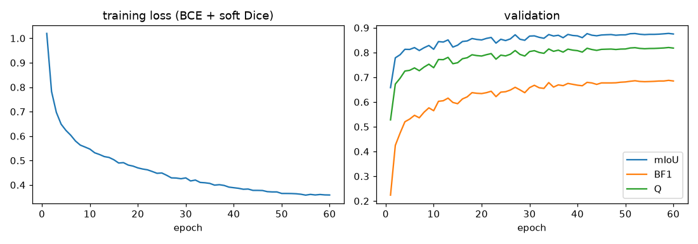
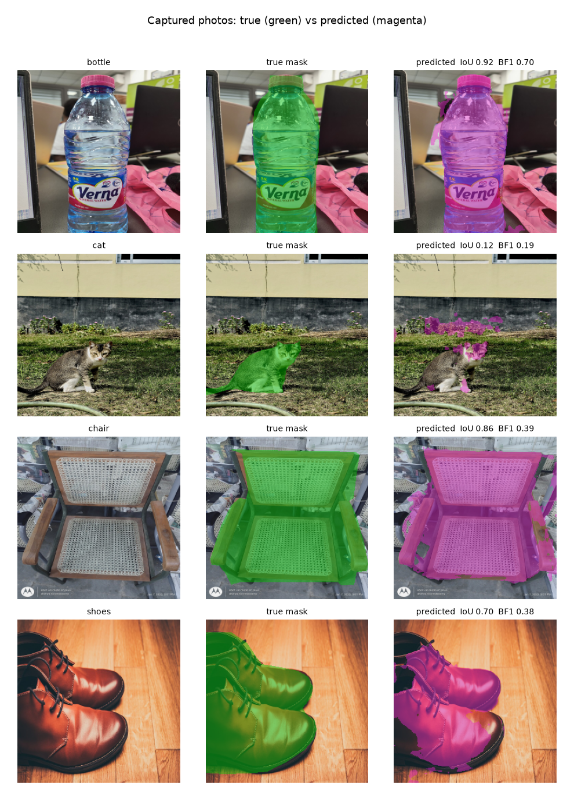
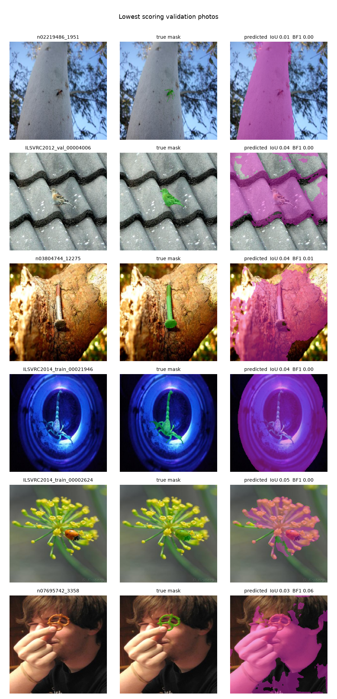

# CV Assignment 2: Cost-Efficient Segmentation

**Track B: tiny fully convolutional network trained from scratch**

> **Note on captured photos:** the photos currently in `captured/` are temporary stand-ins
> (freely licensed Wikimedia Commons photos, masks traced by hand). They will be replaced by
> my own phone photos. The captured-photo row and Section 6 will then be regenerated with
> `src.evaluate --sets captured` and `src.make_figures`.

## 1. Final results

| Set | images | mIoU | Boundary F1 | Q |
|---|---:|---:|---:|---:|
| Validation (held out from DUTS-TR) | 1,053 | 0.8767 | 0.6873 | 0.8199 |
| **DUTS-TE** | 5,019 | **0.7249** | **0.5069** | **0.6595** |
| Captured photos (placeholders) | 4 | 0.8156 | 0.4165 | 0.6959 |

| T_CPU (DUTS-TE, single thread) | S_disk | **CES** (on DUTS-TE) |
|---:|---:|---:|
| 4.79 ms | 336,642 B (0.32 MiB) | **0.6416** |

CES = 0.6595 × (1 − 0.20·4.79/50 − 0.10·336642/4194304) = 0.6595 × 0.9728 = 0.6416.

- **CPU:** AMD Ryzen 5 5600H with Radeon Graphics, Windows 11, PyTorch 2.14.1, 1 thread.
- **Training GPU:** NVIDIA GeForce GTX 1650 (4 GB).
- **Data split:** DUTS-TR (10,553 photos) was split with a fixed seed (2024) into **9,500 training** and **1,053 validation** photos.
- **Use of DUTS-TE:** every design choice (architecture, loss, epoch, weight format) was made on validation. DUTS-TE was used once at the end, for this table and for timing.

## 2. Method

### Data
- Every photo is resized to 256×256 with `cv2.INTER_AREA` and every mask with `cv2.INTER_NEAREST`. A mask pixel is object if its value is ≥ 128.
- The resized data is cached once as memory-mapped uint8 arrays (`src/prepare_data.py`).
- Photos stay in OpenCV's BGR order end to end, so the pipeline needs no colour conversion.

### Network (`src/model.py`)
A small U-Net (about 299K parameters) built from depthwise separable convolutions. Width figures below are channel counts.

| Part | Layers | Output size (for a 128×128 input) |
|---|---|---|
| Stem | 3×3 conv, stride 2, 48 ch, BN, ReLU | 64×64 |
| Encoder 1 | 2 depthwise separable blocks, 64 ch (first block stride 2) | 32×32 |
| Encoder 2 | 3 depthwise separable blocks, 128 ch (first block stride 2) | 16×16 |
| Encoder 3 | 4 depthwise separable blocks, 192 ch (first block stride 2) | 8×8 |
| Global context | global average pool → 1×1 conv, added to every position of encoder 3 | 8×8 |
| Decoder (×3) | bilinear ×2 upsample, **concatenate** the encoder skip of the same size (U-Net style), depthwise separable block | back to 64×64 |
| Head | 1×1 conv to one object logit | 64×64 |

- **Depthwise separable block:** depthwise 3×3 conv, BN, ReLU, then pointwise 1×1 conv and BN, with a residual connection when the shapes match, then ReLU.
- **Global context:** gives every pixel image-level information (what is the main object?) at almost no cost.
- **Output:** the 64×64 logit is bilinearly upsampled to 256×256 and thresholded at 0.

### Training (`src/train.py`)
- **Loss:** pixel-wise binary cross entropy plus soft Dice, computed at 256×256. One logit with binary cross entropy is the two-class cross entropy written with one output channel.
- **Boundary weighting:** BCE is weighted ×3 within 2 px of the true outline, because BF1 only rewards outlines within a 5×5 window.
- **Optimiser:** AdamW (lr 3·10⁻³, weight decay 10⁻⁴), 1 warm-up epoch, then cosine decay. Batch 32, mixed precision, 60 epochs (about 25 min on the GTX 1650).
- **Augmentation (on the GPU):**
  - Geometric: random zoom 0.8–1.45, aspect ±15%, rotation ±12°, shift ±12%, horizontal flip. Image and mask share the same warp.
  - Photometric: brightness, contrast, saturation, per-channel colour cast (mimics tube light vs daylight), gamma, occasional blur and sensor noise.
- **Model selection:** the checkpoint with the best **validation Q** (epoch 59).



### Design choices (all on validation)
- Each candidate was trained for 50 epochs.
- T is the deployed float16 pipeline timed on 500 validation photos with the CPU otherwise idle.
- valCES uses validation Q in place of DUTS-TE Q.

| Run | Input | Widths | Params | Loss | T (ms) | val mIoU | val BF1 | val Q | valCES |
|---|---|---|---:|---|---:|---:|---:|---:|---:|
| r128_w16 | 128 | 16-24-40-64 | 30K | BCE+Dice | 1.84 | 0.840 | 0.564 | 0.757 | 0.750 |
| r256_w16 | 256 | 16-24-40-64 | 30K | BCE+Dice | 4.00 | 0.837 | 0.584 | 0.761 | 0.748 |
| r192_w24 | 192 | 24-32-64-96 | 65K | BCE+Dice | 3.84 | 0.860 | 0.628 | 0.790 | 0.776 |
| r128_w32 | 128 | 32-48-96-128 | 150K | BCE+Dice | 3.06 | 0.865 | 0.640 | 0.797 | 0.782 |
| r128_w32 deeper (2-4-6) | 128 | 32-48-96-160 | 260K | BCE+Dice | 3.53 | 0.869 | 0.650 | 0.803 | 0.781 |
| r128_w32 + boundary weight | 128 | 32-48-96-128 | 150K | +boundary | 3.00 | 0.868 | 0.656 | 0.805 | 0.789 |
| r128_w48 | 128 | 48-64-128-192 | 299K | BCE+Dice | 4.09 | 0.874 | 0.670 | 0.813 | 0.787 |
| **final:** r128_w48 + boundary weight, 60 epochs, int8 | 128 | 48-64-128-192 | 299K | +boundary | 4.79* | 0.877 | 0.687 | 0.820 | — |

\*Official T_CPU on DUTS-TE.

What the sweep showed:
- **Width matters more than input resolution.** Running at 256 instead of 128 costs twice the time for +0.004 Q, while doubling the width gains +0.04.
- **The boundary weight** adds about +0.007 Q, almost all of it through BF1.
- At these sizes, time and file size cost only 1–3% of Q. So the final choice is the widest tested model with the boundary loss, stored as int8 to halve the file-size penalty.

## 3. How the pipeline was kept fast

The timed part (`src/pipeline.py`, `Segmenter.__call__`) goes from a 256×256 BGR uint8 array to a 256×256 {0,1} array:
1. `cv2.resize` to 128×128 (`INTER_AREA`).
2. The network, on a uint8→float tensor.
3. `cv2.resize` of the 64×64 logit to 256×256 (bilinear).
4. Threshold at 0.

Every step counts toward T_CPU. Speed measures, with single-thread numbers from `src/bench_arch.py`:
- **Fold BatchNorm and input scaling into the convs.** Every BN is folded into the conv before it, and the 1/255 input scaling into the stem weights. At test time the network is plain convs and ReLUs applied directly to raw pixel values, with no normalisation step.
- **Work at 128×128, output at 64×64.** About 4× fewer operations than working at 256. The validation sweep showed that 256 input doesn't pay for itself.
- **Channels-last memory layout.** oneDNN runs these small depthwise and 1×1 convs much faster in this layout: 9.1 ms → 7.0 ms for the smallest model with TorchScript in both cases (an early test with another job running, so absolute times are high), and 21.6 → 13.5 ms for r192_w24.
- **TorchScript trace + freeze.** Removes Python overhead between layers and folds constants. `optimize_for_inference` was measured too and was slower.
- **Upsampling and thresholding outside PyTorch.** Profiling showed that `F.interpolate` of the one-channel logit to 256×256 plus the `> 0` comparison took about 1.5 ms per photo. `cv2.resize` (same half-pixel convention as `align_corners=False`) and a NumPy threshold take about 0.1 ms.
- **Single thread throughout.** The thread environment variables are set before NumPy, OpenCV and PyTorch are imported, plus `cv2.setNumThreads(1)` and `torch.set_num_threads(1)`. There is a warm-up run before timing. T_CPU is summed with `time.process_time()` per photo over all 5,019 DUTS-TE photos (`src/time_cpu.py`).
- **Timer resolution on Windows:** `time.process_time()` advances in 15.6 ms clock ticks. The 20-run average printed by `predict.py` (about 100 ms of CPU in total) is therefore coarse and noisy: it moves in steps of 0.78 ms, and repeated runs printed 6.25 and 12.50 ms. The 5,019-photo average is the reliable figure.

### Parameter file (`weights/model.pt`, 336,642 bytes)
- Plain `torch.save` of `{"config", "state"}`, with no extra compression.
- Conv weights are stored as **int8 with one float32 scale per output channel**. Biases are float16.
- The weights are dequantized to float32 once at load time, which is not timed.
- On the 1,053 validation photos this gives the same Q as float16 storage (0.8128 vs 0.8127 for the w48 sweep model), while cutting the file from 615 KB to 341 KB.
- All learned values are in this file. The code holds only the architecture.

## 4. Metrics implementation (`src/metrics.py`)
- **mIoU:** one 2×2 confusion matrix summed over the whole set, then the mean of background IoU and object IoU.
- **Boundary pixels:** an object pixel with a background 4-neighbour. Computed by comparing the zero-padded mask with its four shifted copies; pixels outside the image count as background.
- **5×5 tolerance test:** vectorised with `F.max_pool2d(kernel 5, stride 1, padding 2)` on each boundary map. That gives, at every pixel, whether any boundary pixel of the other mask lies in its 5×5 window. Precision, recall and F1 are computed per image, then averaged.
- **Special cases:** BF1 = 1 when neither mask has a boundary, and 0 when only one does.
- **Testing:** `tests/test_metrics.py` compares both metrics against a direct pixel-by-pixel loop on 34 random and edge-case masks. All match exactly.

## 5. Generalisation: validation vs DUTS-TE
- **The gap:** Q drops from 0.82 on validation to 0.66 on DUTS-TE.
- **Data checked:** cached masks match the raw files, and images and masks are aligned.
- **Smaller objects:** objects cover on average **27%** of a DUTS-TR photo but only **15%** of a DUTS-TE photo.
- **More complete failures:** 18.5% of DUTS-TE photos get object IoU < 0.3, versus 3% on validation.
- **Different sources:** DUTS-TE comes from different image sources with more cluttered scenes, small objects and multiple objects.
- **Why validation looks better:** validation comes from the same distribution as training, so it overestimates performance on DUTS-TE. That's why the assignment asks for both.

## 6. Captured photos

The photos currently in `captured/` are placeholders. Conditions covered:

| Photo | Indoor/outdoor | Lighting | Distance | Background |
|---|---|---|---|---|
| bottle | indoor | tube light | near | cluttered desk |
| chair | indoor | — | near | cluttered |
| shoes | indoor | warm light | very near, cut by the frame | — |
| cat | outdoor | harsh daylight | medium | grass, with shadows |

True masks are green and predictions magenta:



| Photo | object IoU | BF1 |
|---|---:|---:|
| bottle | 0.92 | 0.70 |
| chair | 0.86 | 0.39 |
| shoes | 0.70 | 0.38 |
| cat | 0.12 | 0.19 |

## 7. Failure cases

**1. Camouflaged object, cluttered outdoor scene (captured: cat, IoU 0.12).**
- **What happened:** the model mostly segments the **pink flowers** along the wall and only the cat's face.
- **Likely cause:** the cat's grey-brown fur has the same colours and texture as the dry grass and soil, under harsh daylight with hard shadows. The flowers are the most colourful, high-contrast region, and saliency datasets often reward exactly that.
- **Contributing cause:** a ~300K-parameter network trained from scratch on 9,500 photos can't learn much about object categories, so colour contrast dominates. With little object knowledge, it can't tell that a cat matters more than flowers.

**2. Small object on a large textured surface (validation photos with IoU < 0.05).**



- **What happened:** in every one of the six worst validation photos, the true object is **small** (an ant on a tree trunk, a bird on a roof, a nail in bark, a ladybird on a flower, a pretzel in front of a face). The model segments the **large surface** instead.
- **Likely cause:** the network's strongest cue is "a big, centred region that differs from the border". At 128×128 input and 64×64 output, a 10-pixel object shrinks to 2–3 output cells, too small to separate from its surroundings.
- **Same cause on DUTS-TE:** this is the main reason for the gap in Section 5, since DUTS-TE contains far more small objects.

**3. Object touching the image border, strong colour cast (captured: shoes, IoU 0.70, BF1 0.38).**
- **What happened:** the shoes fill the frame and are cut by its left and bottom edges. The model misses the dark heel and the part of the lower shoe that touches the border.
- **Likely cause:** most DUTS training objects are away from the border, so the model has learned that border regions are background.
- **Contributing cause:** the dark brown leather in strong warm light is close in colour to the wooden floor, so colour contrast doesn't help.

**Boundary accuracy in general.** Even where IoU is high (chair 0.86), BF1 is lower (0.39):
- Thin parts like the chair's arm-rest gaps and the cane mesh can't be resolved by a 64×64 logit map upsampled 4×.
- Hand-drawn polygon masks are themselves only accurate to a few pixels.

## 8. Reproducing
See [README.md](../README.md). In short:
```
python -m src.prepare_data
python -m src.train --name final --in-res 128 --widths 48 64 128 192 --depths 2 3 4 --epochs 60 --boundary-weight 2
python -m src.export --ckpt checkpoints/final.pt --out weights/model.pt --int8
python -m src.time_cpu
python -m src.evaluate
python -m src.make_figures --run final
python predict.py --image photo.jpg --out mask.png
```
